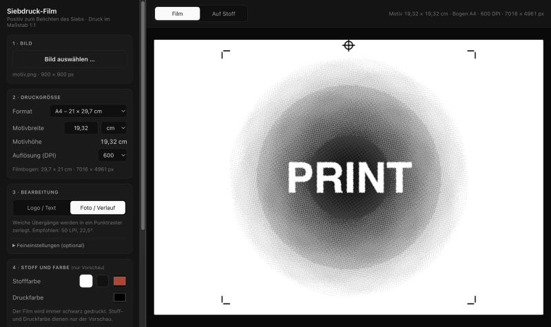

# Siebdruck-Film

Web-App, die aus einem Bild einen druckfertigen Film für den Siebdruck erstellt – direkt im Browser, ohne Upload und ohne Server.

**Live-Demo:** https://bit0606.github.io/siebdruck-film/



## Funktionen

- **Logo / Text:** Umwandlung in reines Schwarz-Weiß. Der Schwellwert wird automatisch mit dem Otsu-Verfahren aus dem Histogramm des Bildes ermittelt und lässt sich manuell anpassen.
- **Foto / Verlauf:** Halbtonraster mit einstellbarer Rasterweite (LPI), Rasterwinkel und Kontrast.
- **Druck im Maßstab 1:1:** Filmbogen A6 bis A3 oder typische Druckbereiche auf dem T-Shirt (Tasche, Brust, Rücken). Die Seitengröße wird über `@page` gesetzt, damit der Ausdruck exakt die gewählte Größe hat.
- **Export als PNG** mit 300 bis 1200 DPI, optional mit transparentem Hintergrund.
- **Passer- und Schnittmarken** für das Ausrichten auf dem Sieb.
- **Vorschau auf Stoff** mit frei wählbarer Stoff- und Druckfarbe.
- Spiegeln, Invertieren, Einheiten in cm, mm und Zoll.

## Technik

- HTML, CSS und JavaScript ohne Frameworks und ohne Abhängigkeiten
- Bildverarbeitung pixelweise über die Canvas-API
- Das Bild verlässt den Rechner nicht, alles läuft lokal im Browser

## Lokal starten

```bash
git clone https://github.com/bit0606/siebdruck-film.git
cd siebdruck-film
python3 -m http.server 8000
```

Danach http://localhost:8000 im Browser öffnen. Alternativ reicht es, `index.html` direkt zu öffnen.

## Hinweise zum Drucken

Im Druckdialog **Skalierung 100 %** bzw. **Tatsächliche Größe** und Ränder **0** wählen, sonst weicht die Größe vom eingestellten Maß ab. Für den Film eignet sich Inkjet-Transparentfolie.
